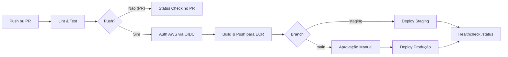
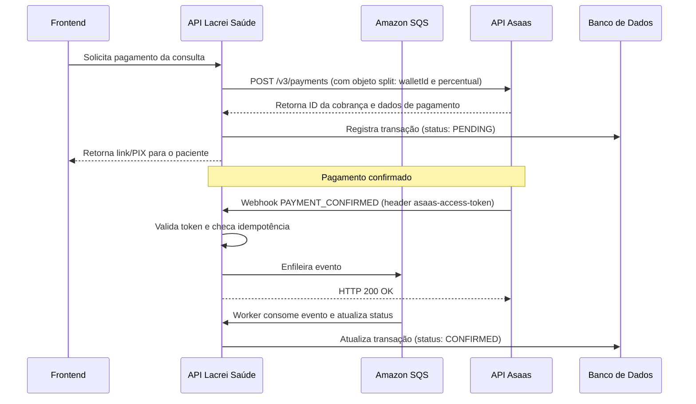

# Desafio Técnico DevOps — Lacrei Saúde

Este repositório contém a aplicação Node.js (`/status`), o `Dockerfile` e os workflows de CI/CD configurados para deploy em ambientes isolados de **staging** e **produção** na AWS.

## Ambientes no ar

| Ambiente | Endpoint | Branch | Deploy |
| :--- | :--- | :--- | :--- |
| Staging | https://3-94-161-47.sslip.io/status | `staging` | Automático após push e CI aprovado |
| Produção | https://52-206-165-100.sslip.io/status | `main` | Merge via PR com aprovação manual no GitHub |

---

## Setup dos ambientes

A infraestrutura foi provisionada na AWS (`us-east-1`) separando completamente staging e produção:

* **Instâncias EC2:** duas instâncias Ubuntu independentes (uma para cada ambiente), com Docker e AWS CLI instalados. Cada instância usa sua própria chave SSH (`.pem`) e possui uma IAM Role associada apenas para leitura de imagens no Amazon ECR.
* **Proxy reverso e HTTPS:** configurado com **Caddy** apontando para os domínios `sslip.io` de cada IP público. O Caddy gerencia automaticamente os certificados TLS via Let's Encrypt e redireciona HTTP para HTTPS. O container da API escuta apenas em `127.0.0.1:3000`, sem exposição direta para a internet.
* **Registry:** repositório privado no **Amazon ECR** (`lacrei-api`), onde as imagens são versionadas com o SHA do commit (`${{ github.sha }}`) e a tag `latest`.
* **Autenticação AWS (OIDC):** criado um Identity Provider OIDC no IAM para o GitHub Actions (`token.actions.githubusercontent.com`) vinculado à role `lacrei-github-actions-role`, eliminando o uso de chaves estáticas (`AWS_ACCESS_KEY_ID` / `AWS_SECRET_ACCESS_KEY`).
* **Secrets e Environments:** no GitHub, foram criados os ambientes `staging` e `production` em *Settings → Environments*. Cada um guarda seus próprios segredos (`EC2_HOST`, `EC2_USER`, `EC2_SSH_KEY`), e o ambiente `production` possui regra de revisão manual obrigatória (*Required reviewers*).

---

## Fluxo de CI/CD



O pipeline principal está em `.github/workflows/ci-cd.yml` e segue três etapas:

1. **Lint & Test (`ci`):** roda `npm ci`, `npm run lint` e `npm test` em qualquer Pull Request ou push nas branches `staging` e `main`.
2. **Build & Push (`build-and-push`):** executa apenas em eventos de `push` após o CI passar. Faz login no ECR via OIDC, gera a imagem a partir do `Dockerfile` (`node:22-alpine`) e sobe as tags `<commit-sha>` e `latest`.
3. **Deploy (`deploy-staging` / `deploy-production`):** acessa a EC2 correspondente via SSH, autentica no ECR, baixa a imagem exata daquele commit, substitui o container anterior e valida se a aplicação subiu com `curl -sf http://localhost:3000/status`.

---

## Processo de Rollback

Para reverter uma versão com problema sem depender de um novo build, o repositório possui um workflow manual dedicado em `.github/workflows/rollback.yml`.

### Passo a passo para reverter
1. No GitHub, acesse **Actions → Rollback → Run workflow**.
2. Escolha o ambiente alvo (`staging` ou `production`).
3. No campo `image_tag`, informe o SHA do commit estável anterior que já está no ECR.
4. Se for produção, aprove a execução na etapa de revisão manual.

O workflow conecta na EC2, faz o pull da tag informada, recria o container e testa novamente a rota `/status`.

---

## Checklist de segurança

* [x] **Autenticação temporária na AWS:** uso de OIDC no lugar de credenciais estáticas.
* [x] **Menor privilégio no IAM:** a role do GitHub Actions só aceita tokens deste repositório e tem permissão restrita ao repositório `lacrei-api` no ECR.
* [x] **Segregação de ambientes:** chaves SSH e hosts separados por *GitHub Environments*, com aprovação manual exigida antes de qualquer deploy em produção.
* [x] **HTTPS obrigatório:** tráfego externo criptografado ponta a ponta via Caddy/Let's Encrypt.
* [x] **Container endurecido:** execução com usuário não-root (`node`) e porta `3000` vinculada apenas ao loopback (`127.0.0.1`).
* [x] **CORS:** como a aplicação atual expõe apenas a rota de healthcheck (`/status`) sem consumo direto por frontends de origens distintas, não foi necessário liberar origens externas. Em um cenário com frontend conectado, a restrição seria aplicada via middleware `cors` permitindo apenas os domínios oficiais da Lacrei Saúde.

---

## Observabilidade e monitoramento

* **Logs de deploy:** registrados por etapa na aba **Actions** do GitHub.
* **Logs da aplicação:** acessíveis diretamente nas instâncias EC2 via `docker logs -f lacrei-api`.
* **Monitoramento e alertas (CloudWatch + SNS):** configurado alarme no **AWS CloudWatch** monitorando a métrica `StatusCheckFailed >= 1` da instância de produção, com envio de notificação por e-mail via **Amazon SNS**.
* **Próximo passo recomendado:** configurar o driver `awslogs` no Docker para centralizar os logs dos containers diretamente no CloudWatch Logs e integrar o tópico SNS a um canal do Slack.

---

## Erros encontrados e decisões tomadas

Durante a construção do pipeline, alguns problemas reais apareceram e guiaram ajustes na arquitetura:

1. **Bloqueio no OIDC (`Not authorized to perform sts:AssumeRoleWithWebIdentity`):**
   * *Diagnóstico:* consultando o **AWS CloudTrail**, identifiquei que o token emitido pelo GitHub incluía IDs numéricos no claim `sub` (`repo:limac43@136931744/lacrei-devops-challenge@1469565109:...`) e que a opção *Trusted identity propagation* estava ativa no provedor OIDC da AWS.
   * *Resolução:* desativei o *Trusted identity propagation* no provedor e ajustei a *Trust Policy* da Role para bater com o padrão exato do `sub`.

2. **Erro `403 Forbidden` no push para o ECR:**
   * *Diagnóstico:* após subir as camadas da imagem, o Docker falhou em uma requisição `HEAD .../manifests/...`. Versões mais novas do Docker checam o manifesto antes de concluir o push, o que exige permissões de leitura além das de escrita.
   * *Resolução:* adicionei `ecr:BatchGetImage` e `ecr:GetDownloadUrlForLayer` na política `lacrei-ecr-push-only`.

3. **Variável de imagem vazia (`IMAGE=""`) no job de deploy:**
   * *Diagnóstico:* o GitHub Actions mascara e descarta automaticamente valores passados via `outputs` entre jobs quando eles contêm dados derivados de *Secrets* (`AWS_REGION` e `ECR_REPOSITORY`).
   * *Resolução:* passei a montar a URI da imagem diretamente dentro do script de cada job de deploy usando `${{ github.sha }}`.

4. **Timeout na porta 22 (`i/o timeout`) durante o deploy via SSH:**
   * *Diagnóstico:* o Security Group inicialmente liberava SSH apenas para o meu IP local, bloqueando os runners do GitHub Actions (que usam IPs dinâmicos).
   * *Resolução:* liberei o acesso SSH para permitir a conexão do pipeline. Como melhoria futura em produção, o ideal seria substituir o deploy via SSH por **AWS Systems Manager (SSM)**, mantendo a porta 22 totalmente fechada.

---

## Bônus: Proposta de arquitetura — Integração Asaas (Split de Pagamento)

Para integrar pagamentos de consultas com divisão automática de valores (*split* entre profissional e plataforma) sem acoplar o tempo de resposta da API ao processamento de webhooks:



**Pontos principais da proposta:**
* **Credenciais:** chave da API (`ASAAS_API_KEY`) e token de validação do webhook armazenados no **AWS Secrets Manager**, separando *Asaas Sandbox* em `staging` e API oficial em `production`.
* **Resiliência:** o endpoint de webhook apenas valida o token (`asaas-access-token`), publica o payload em uma fila **Amazon SQS** (com *Dead Letter Queue*) e responde `200 OK` rapidamente para evitar retries desnecessários do Asaas.
* **Idempotência:** o worker usa o `payment.id` do Asaas como chave única antes de atualizar o banco, evitando duplicidade caso o mesmo evento seja entregue mais de uma vez.

---

## Executando localmente

```bash
git clone [https://github.com/limac43/lacrei-devops-challenge.git](https://github.com/limac43/lacrei-devops-challenge.git)
cd lacrei-devops-challenge

npm ci
npm run lint
npm test

# Via Docker
docker build -t lacrei-api:local .
docker run -p 3000:3000 lacrei-api:local
curl http://localhost:3000/status
```
